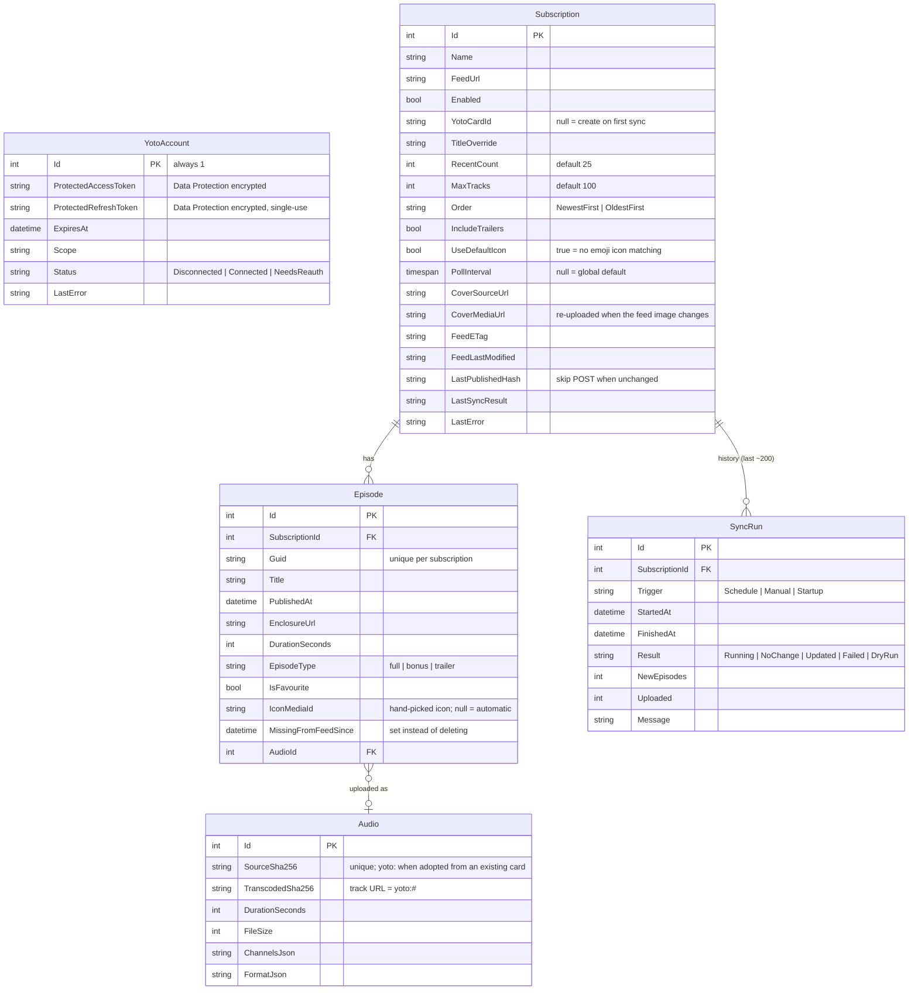
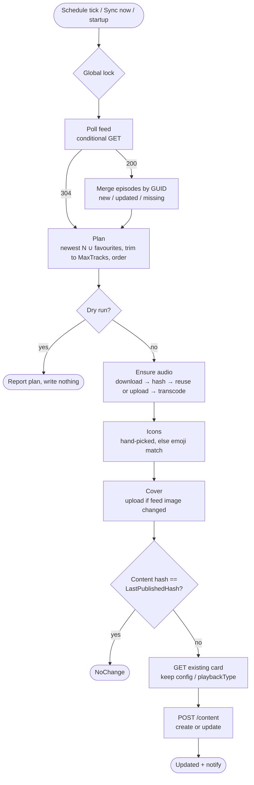

# PodcastToYotoPlaylist — Design

Status: draft v1 (2026-10-05). Builds on [requirements.md](requirements.md) and [spikes.md](spikes.md).

## Key choices

| Area | Choice | Why |
|---|---|---|
| Host | Single ASP.NET Core app (.NET 10): web UI + background sync in one process | One container, one volume, no queue/infra |
| UI | Blazor (Interactive Server) | All C#, live status updates over SignalR for free, no JS build chain. Internal tool with one user, so server-side circuits are fine. |
| Persistence | EF Core + SQLite in `/data/app.db` | Zero-ops, migrations, easy to inspect |
| Scheduling | `BackgroundService` + `PeriodicTimer` + `Channel` for "sync now" | Nothing beyond the BCL needed; one sync at a time |
| Secrets at rest | ASP.NET Data Protection (keys in `/data/keys`) for the stored tokens | Cheap; tokens aren't plaintext in the DB file |
| Logging | `Microsoft.Extensions.Logging` console (JSON formatter option) | No extra dependencies |
| User auth | None in-app; Traefik + PocketID forward-auth in front | Already in place. App must only be reachable through Traefik (firewall / no published port). |

## Solution layout

```
src/
  PodcastToYoto.Core/     Yoto API client, OAuth/PKCE, RSS parser, episode downloader (no persistence)  [exists]
  PodcastToYoto.Web/      ASP.NET Core host: EF Core, sync engine, scheduler, auth endpoints, Blazor UI
tests/
  PodcastToYoto.Tests/    xUnit: feed parsing, playlist planning, sync engine against a fake Yoto API
tools/
  YotoSpike/              Spike CLI (kept for poking at the API)                                       [exists]
```

Split `Web` into `Web` + `Sync` later only if it gets unwieldy.

## Data model

> Since M8 the target card, title, cover, schedule, sync state and `SyncRun`s belong to a `Playlist` that owns one or more ordered `Subscription`s (one per podcast). See M8 under Milestones.



`Audio` has one row per distinct source file and is shared across subscriptions, so the same episode on two cards is only uploaded once. `YotoAccount` is a single row.

Episodes are never deleted when they fall out of the feed (`MissingFromFeedSince` is set instead), so favourites from the back-catalogue stay playable.

## Sync engine



Runs per subscription, one subscription at a time:

1. **Poll**: conditional GET with ETag / Last-Modified. A 304 skips parsing. Otherwise upsert episodes by GUID and record new ones.
2. **Plan** (pure function, unit tested):
   - candidates = episodes, excluding trailers unless `IncludeTrailers`
   - desired = newest `RecentCount` ∪ favourites
   - if the count is over `MaxTracks`, drop the oldest non-favourites, then the oldest favourites; warn either way
   - sort by `Order`
3. **Ensure audio**: for each desired episode without an `Audio` row, download it, hash it, and reuse an `Audio` row with the same source hash if there is one. Otherwise upload → transcode → insert `Audio`. Each episode is saved as it completes, so a crashed sync resumes cheaply. Yoto's own sha dedupe (`uploadUrl: null`) skips the PUT for files it already has.
4. **Ensure card**: no `YotoCardId` → create the playlist. Cover is uploaded once and refreshed when the feed image changes.
5. **Publish**: build the `/content` body. On update, first `GET /content/{cardId}` and keep the existing `content.config` / `playbackType`, so Yoto-side settings like resume timeout aren't reset. Hash the body: if it matches `LastPublishedHash`, skip the POST. Otherwise POST with `cardId` and store the hash.
   - Card deleted or not found → mark the subscription failed with "playlist missing"; the UI offers "create new playlist".

**Failure handling**:
- Yoto 401 or a failed refresh → account becomes `NeedsReauth`, all syncs pause, and the UI shows a banner.
- Transient errors are retried in the API client; anything else is recorded on the `SyncRun` and retried next interval.

**Scheduler**:
- Ticks every minute and runs subscriptions whose last (non-dry-run) sync started more than `PollInterval` ago.
- "Sync now" posts the subscription ID to a channel.
- Optionally runs once on startup.
- A global lock means only one sync runs at a time.

## Yoto auth (web flow)

- `GET /auth/login` generates the PKCE verifier and state, keeps them in a short-lived Data-Protected cookie, and redirects to Yoto.
- `GET /auth/callback` validates state, exchanges the code, saves the tokens and redirects to `/`.
- `POST /auth/disconnect` clears the tokens.
- `redirect_uri` = `{App:PublicBaseUrl}/auth/callback`, always taken from config and never from the request. Forwarded headers are enabled for correct scheme and host in logs and links.
- `DbTokenStore : ITokenStore` plugs into the existing `YotoTokenProvider`. Rotated refresh tokens are saved before use.

## UI

| Page | Contents |
|---|---|
| `/` Dashboard | Playlists with status, last sync, next sync, episode counts; a "Yoto connected" pill, or a banner linking to Settings when Yoto isn't connected or needs re-login |
| `/subscriptions/new` | Feed URL → preview (title, cover, latest episodes) → settings → target playlist: pick existing (`/content/mine`) or "create new" |
| `/subscriptions/{id}` | Settings; **Episodes** table (favourite toggle, on-playlist indicator, date, duration); **Planned playlist** preview; sync history; dry-run button |
| `/settings` | Yoto account (connect / test / reconnect / disconnect, scopes); backups (back up now, export settings, download), import JSON; read-only view of configuration |

## Configuration

`appsettings.json` / environment variables (`Section__Key`):

| Key | Default | Notes |
|---|---|---|
| `App:PublicBaseUrl` | — (required) | `https://yoto.example.com` |
| `App:DataDirectory` | `/data` (container), `<repo>/.data` (dev) | DB, Data Protection keys, temp downloads |
| `Yoto:ClientId` | — (required) | |
| `Sync:DefaultPollInterval` | `01:00:00` | |
| `Sync:RunOnStartup` | `true` | |
| `Sync:DryRun` | `false` | Global kill-switch for writes to Yoto |

Dev: `launchSettings.json` binds `http://0.0.0.0:5164`. Container: listens on 8080.

## Observability

- Log events: episode discovered, upload complete (with timings), playlist published, sync failed, auth needs re-login.
- `/health` covers DB reachability and the Yoto account state. It's excluded from PocketID if uptime checks are wanted.
- `INotificationSink` has a log implementation now and Home Assistant later.

## Milestones

1. **M1 Foundation** ✅ *(2026-10-05)*: Web project, EF Core + migrations, Data Protection, Yoto connect/reconnect flow, dashboard showing account status.
2. **M2 Feeds** ✅ *(2026-10-05)*: subscription CRUD, feed preview, polling + episode upsert, episodes table.
3. **M3 Sync** ✅ *(2026-10-05)*: planner, audio pipeline, publish, scheduler, Sync now, sync history. *End-to-end usable here.*
4. **M4 Curation** ✅ *(2026-10-05)*: favourites (+ clear all); target an existing playlist (picker on create and in settings) — its tracks are matched to feed episodes by normalised title so their audio is reused, optionally kept as favourites, and automatic sync is paused until reviewed; playlist links open the card in the Yoto web app; planned-playlist preview; export/import JSON (`/export.json`, `/settings`).
5. **M5 Deploy** ✅ *(2026-10-05, running at yoto.example.com)*: multi-stage Dockerfile (non-root, `/data` volume, port 8080), `deploy/compose.yaml` (included from the server's parent services compose; shared `services` network, Traefik labels + PocketID middleware, explicit DNS), `build.ps1` (test, build, optional tarball / local-registry push), GitHub Actions CI (build + test only; no image publishing).

6. **M6 Polish** ✅ *(2026-10-06)*: episode icons (plus a per-episode icon picker that overrides the automatic match) — emoji in the title → Unicode name → keyword match against Yoto's public icons (title +3, tags +1, shortest title wins; title-word fallback), per-subscription opt-out, shown in the episodes table; Home Assistant notifications (webhook and/or REST service call, event filter, test button) via a fan-out `Notifier` over `INotificationChannel`s.

7. **M7 Ops** ✅ *(2026-10-06)*: nightly in-app backup (`BackupService`: SQLite online backup + Data Protection keys + JSON export → zip, keep 14, Settings card with download / back up now); `build.ps1 -Deploy` ships the image to the server (docker save → scp → docker load, or a registry with `-Registry`) and restarts it with compose over ssh.

8. **M8 Multi-podcast playlists** ✅ *(2026-10-08)*: `Playlist` is the top-level entity (Yoto playlist, title, cover, schedule, sync state, history, max total tracks, order: newest / oldest first or grouped by podcast) and owns ordered `Subscription`s (one per podcast, with its own recent count, max episodes, order, trailers, icon settings, and an "included" flag). The planner picks per podcast, then merges, caps and orders; the sync polls each included podcast (one broken feed doesn't block the rest) and publishes as before. Migration `MultiPodcastPlaylists` turns each subscription into a one-podcast playlist with the same id, card, title, cover and history, so nothing republishes. Podcast logo icons: 16×16 crops of the artwork generated with SkiaSharp, uploaded via `POST /media/displayIcons/user/me/upload`, used as a fallback or on every episode. Export format v2 (v1 still imports). UI: dashboard lists playlists; `/playlists/{id}` (podcasts, planned tracks, history); `/playlists/{id}/podcasts/{id}` (podcast settings, logo icon, episodes); old `/subscriptions/{id}` links redirect.

   **M8.1** *(2026-10-10)*: track order split into `Order` (newest / oldest first, title A–Z / Z–A) and `GroupByPodcast`; a podcast's own order (`UseOwnOrder`) applies only when grouped (migration `PlaylistGrouping`; old `GroupedByPodcast` values and exports map across). Icon picker: "Podcast default" and "Clear" sentinels in `Episode.IconMediaId`, and editable from the playlist page; logo icon can be an existing custom (`GET /media/displayIcons/user/me`) or public Yoto icon. Drag-and-drop podcast order; merged Backups card with Export settings; phone layout fixes.

## Later / ideas

- Integration tests for the sync engine against a fake Yoto API.
- Uptime monitoring of `/health` from Home Assistant.

